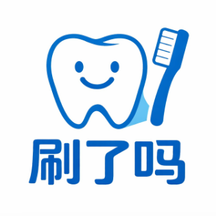
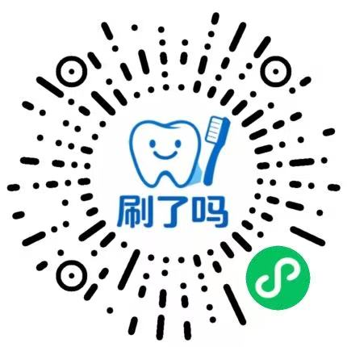
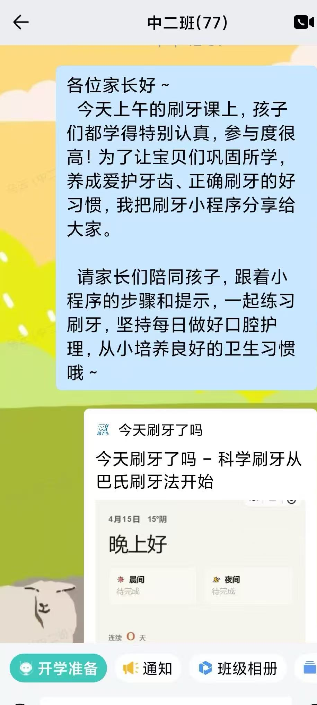

# Dentic - Did You Brush Today?

[](https://developers.weixin.qq.com/miniprogram/dev/framework/)
[](https://taro.zone/)
[](https://react.dev/)
[](https://www.typescriptlang.org/)
[](#license)

[中文](./README.md) | [English](./README.en.md)



A WeChat Mini Program based on the Bass brushing method, designed to guide children toward scientific brushing and consistent daily habits.

**Fully offline with zero backend** — all data stays on the device. No personal information is collected or uploaded.

## Mini Program QR Code



## Features

- **Guided Bass Brushing Flow**: 15-step guided brushing with countdown, step prompts, and completion feedback
- **Brushing Session State Machine**: idle / countdown / brushing / paused / completed states
- **Audio + Haptics + Wake Lock**: voice/step audio, vibration feedback, and keep-screen-on during brushing
- **Morning/Evening Tracking**: records by business date with separate morning and evening completion status
- **History Calendar & Stats**: monthly calendar, same-day morning/evening timestamps, streak/total days/month completion rate
- **Profile Center**: on-device avatar and nickname, reminder/sound/voice toggles
- **Share Capability**: share to contacts and Moments
- **Privacy Friendly**: no network requests, no location permission, no account system

## Pages & Routes

From `src/app.config.ts`:

- `pages/index/index`: brushing home
- `pages/history/index`: history and stats
- `pages/profile/index`: profile center (settings included)

## Tech Stack

| Area | Solution |
|------|------|
| Framework | Taro 4 + React 18 + TypeScript |
| State Management | Zustand (vanilla stores + persistence) |
| Build | Taro CLI + Vite Runner |
| Styling | Sass + Tailwind CSS |
| Backend | None (local `Taro.setStorageSync` only) |
| Code Quality | ESLint + TypeScript typecheck |

## Project Structure (Current)

```text
src/
├── pages/
│   ├── index/           # brushing home
│   ├── history/         # history and stats
│   └── profile/         # profile center (settings)
├── domains/
│   └── brush/
│       ├── hooks/       # brushing state/effect orchestration
│       ├── components/  # brushing UI states
│       ├── effects/     # audio/vibration/wake-lock adapters
│       └── repositories/# brushing data repository (save)
├── components/          # page-level and shared UI components
├── stores/              # profile/settings/records stores
├── services/            # state machine, date boundary, storage, audio, share
├── constants/           # brushing steps, etc.
└── assets/              # icons, audio, etc.
```

## Data Storage

- All data is stored **on-device** via `Taro.setStorageSync` (isolated per device + mini program).
- **Note**: uninstalling the mini program, clearing WeChat cache, or switching devices **will cause data loss**. Keep important records elsewhere.
- Limits are 1MB per key and 10MB total — far beyond what brushing records require.

## Quick Start

```bash
# Install dependencies
pnpm install

# WeChat Mini Program development
pnpm run dev:weapp

# WeChat Mini Program build
pnpm run build:weapp

# Lint
pnpm run lint

# Auto-fix lint issues
pnpm run lint:fix

# Type check
pnpm run typecheck
```

### Local Debug Notes

1. Run `pnpm run dev:weapp` to generate `dist/`.
2. Import the project root into WeChat DevTools (`miniprogramRoot` is `dist/` in `project.config.json`).
3. No server domain configuration and no cloud function deployment required — the project runs out of the box.

## Success Case

### First Offline Kindergarten Brushing Health Class Collaboration

In an offline kindergarten brushing health class, the mini program was used as a classroom teaching aid for the first time. After the in-class demonstration, parents could follow the guided steps with their children at home, creating a closed loop of "classroom learning + family practice."



## License

MIT
